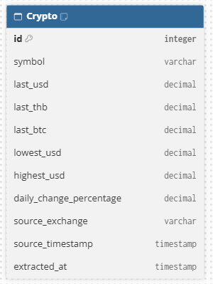

# 📋 PROJECT BRIEF #01: Automated Crypto & Currency ETL Pipeline
**Assignee:** @Junior_DE (Year 1 CSDS)  
**Reviewer:** Senior Data Engineer (AI)
**Status:** `🟡 In Progress`  
**Deadline:** **วันศุกร์ที่ 4 ธันวาคม 2026**
---

### 🎯 โจทย์และเป้าหมาย (Objective)
ทีมวิเคราะห์การลงทุนต้องการข้อมูลราคาเหรียญคริปโตเคอร์เรนซี (เช่น BTC, ETH, SOL) เทียบกับค่าเงินบาท (THB) และดอลลาร์ (USD) แบบรายวัน เพื่อนำไปใช้วิเคราะห์แนวโน้มย้อนหลัง คุณต้องสร้างระบบดึง แปลง และจัดเก็บข้อมูลนี้ลงฐานข้อมูลให้พร้อมใช้งานโดยไม่พัง

---

### 🛠️ ข้อบังคับทางเทคนิค (Technical Requirements)
1. **Tech Stack:** ใช้ **Python** เป็นหลัก (แนะนำ `requests`, `pandas`)
2. **Extract (ดึงข้อมูล):** 
  - ดึงข้อมูลจาก **CoinGecko Public API** (ฟรี ไม่ต้องใช้ API Key) อย่างน้อย 5 เหรียญ
3. **Transform (แปลงและทำความสะอาดข้อมูล):**
  - เลือกเฉพาะคอลัมน์ที่จำเป็น (`id`, `symbol`, `last_usd`, `last_thb`, `last_btc`, `lowest_usd`, `highest_usd`, `daily_change_percentage`, `source_exchange`, `source_timestamp`, `extracted_at`)
  - **เพิ่มคอลัมน์คำนวณใหม่:** แปลงราคาจาก USD เป็น THB (ดึงเรตเงินจาก Exchange Rate API ฟรี หรือตั้งตัวแปรเรตเงินไว้ในโค้ด)
  - แปลง **Timezone** ของ `last_updated` ให้เป็นเวลาประเทศไทย (`Asia/Bangkok` / UTC+7) ทั้งหมด
4. **Load (จัดเก็บลงฐานข้อมูล):**
  - **ห้าม** จบแค่ไฟล์ CSV/Excel ต้องโหลดลงฐานข้อมูล SQL จริงๆ (**SQLite** หรือ **PostgreSQL**)
  - **กฎเหล็ก (Idempotency):** ถ้ารันสคริปต์ซ้ำในวันเดียวกัน ข้อมูลใน Database **ห้ามเบิ้ลหรือซ้ำซ้อน** (ต้องใช้ `UPSERT` / `INSERT OR REPLACE` หรือเขียน Logic ดักไว้)
5. **Security:** ห้าม Hardcode รหัสผ่านหรือ URL ลับลงในโค้ด ให้เก็บใน `.env` และสร้าง `.gitignore` กันหลุดขึ้น GitHub

---

### 📦 ผลลัพธ์ที่ต้องส่ง (Deliverables)
ส่งลิงก์ **GitHub Repository (Public)** ที่มีองค์ประกอบครบดังนี้:
- `📁 Source Code:` โค้ด Python ที่แบ่งไฟล์เป็นระเบียบ (เช่น `extract.py`, `transform.py`, `load.py` หรือ `main.py` ที่อ่านง่ายและมี Comment)
- `📄 requirements.txt:` ระบุ Library ทั้งหมดที่ใช้
- `📖 README.md:` อธิบายโปรเจกต์โดยต้องมี:
  - **Architecture Diagram** (วาดจาก Excalidraw / Draw.io) แสดงการไหลของข้อมูล API -> Python -> DB
  - **Database Schema** ตารางอธิบายชื่อคอลัมน์และ Data Type
  - **How to run** วิธีติดตั้งและรันโค้ดตั้งแต่ต้นจนจบ
- `📸 Screenshot:` ภาพผลลัพธ์จากการรันคำสั่ง SQL Query ดึงข้อมูลใน DB ออกมาโชว์ (เช่น `SELECT * FROM crypto_prices LIMIT 10;`) แปะใน README

### Data Pipeline diagram

### ER diagram

